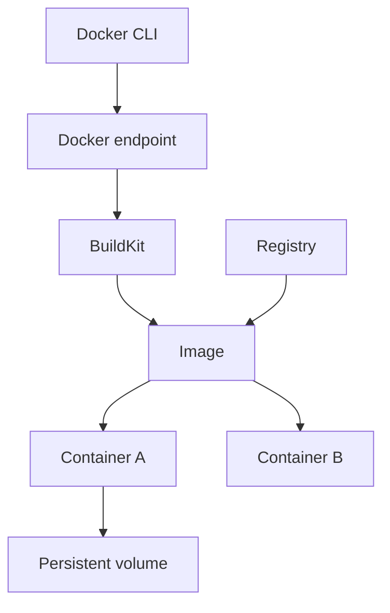
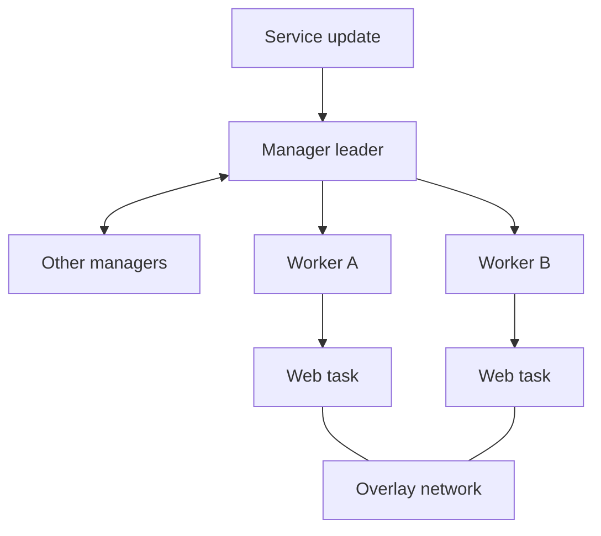
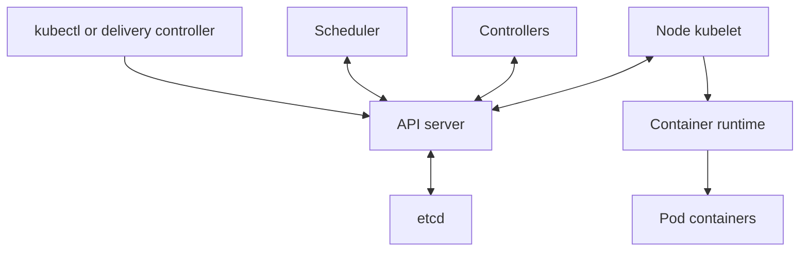
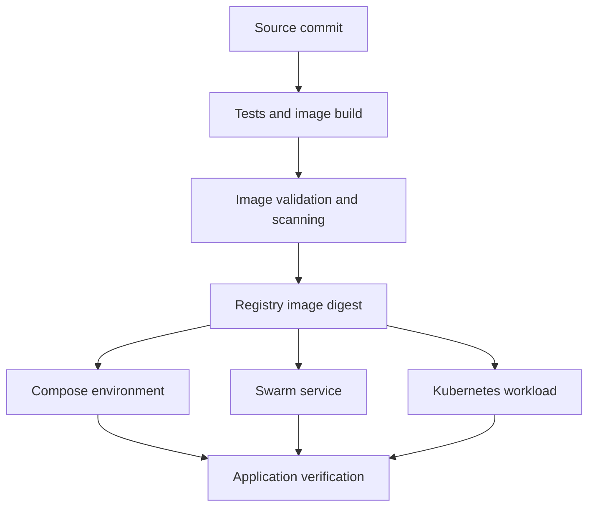

# Docker, Docker Swarm & Kubernetes

**A practical guide to containers and orchestration**

One reference for learning container fundamentals, building images, running local applications, operating Swarm services, and deploying workloads to Kubernetes. Includes complete examples, daily commands, Jenkins workflows, troubleshooting, and interview preparation.

**Learning order:** Docker and Compose → Docker Swarm → Kubernetes → delivery and operations. Swarm and Kubernetes are alternative orchestration platforms; an application does not need to pass through Swarm before it can run on Kubernetes.

**Single-file repository:** This README contains every example as a code block. Upload it as `README.md` at your repository root. Files such as `app.py`, `Dockerfile`, `compose.yaml`, and `web.yaml` are files you create locally while following the labs; they are not missing companion downloads.

> **Scope and verification:** Linux-first learning examples, with modern Docker Compose syntax and stable Kubernetes core APIs. Markdown navigation, YAML syntax, and shell syntax were checked. The Python demo's HTTP routes passed a local smoke test. Complete Docker, multi-node Swarm, and Kubernetes execution were not tested in the authoring environment. Readable image tags are used for learning; record tested immutable image digests for production. Official references were consulted on 4 October 2026 (IST).

## Contents

1. [Foundations and tool comparison](#1-foundations-and-tool-comparison)
2. [How to use the labs](#2-how-to-use-the-labs)
3. [Docker and Compose](#3-docker-and-compose)
4. [Docker Swarm](#4-docker-swarm)
5. [Kubernetes](#5-kubernetes)
6. [End-to-end delivery workflow](#6-end-to-end-delivery-workflow)
7. [Production checklist](#7-production-checklist)
8. [Interview questions and practice](#8-interview-questions-and-practice)
9. [Official references](#9-official-references)

Each technology chapter has its own detailed navigation below.

## 1. Foundations and tool comparison

An **image** packages an application, its user-space dependencies, and runtime defaults. A **container** is an instance of that image. An **orchestrator** schedules and manages containerized workloads across a cluster.

Docker provides image-building and container-running tools. Compose describes a multi-container application on a Docker endpoint. Swarm adds cluster services to Docker Engine. Kubernetes uses an API and controllers to reconcile desired workload state.

| Capability | Docker Engine / Compose | Docker Swarm | Kubernetes |
|---|---|---|---|
| Primary workload unit | Container / Compose service | Service and task | Pod and workload controller |
| Image building | Docker/BuildKit | Build separately, then deploy images | Build separately, then deploy images |
| Normal scheduling scope | One Docker endpoint | Multiple Docker Engine nodes | Multiple cluster nodes |
| Desired-state configuration | Dockerfile and Compose YAML serve different roles | Stack YAML / service specification | API manifests, often managed with Helm or Kustomize |
| Scaling | Container/service instances on the selected endpoint | Replicated or global services | Controllers; HPA with metrics integration |
| Cross-host networking | Requires additional networking design | Overlay networks and service discovery | CNI networking and Services |
| Persistent data | Volumes and bind mounts | Storage reachable by scheduled tasks | Volumes, PVCs, PVs, CSI drivers |
| Typical learning goal | Package and run an application | Understand cluster scheduling and service operations | Operate application workloads through Kubernetes APIs |

**Tools have different responsibilities:** Jenkins orchestrates delivery jobs; registries distribute images; Terraform provisions infrastructure; observability systems collect metrics, logs, and traces. Container orchestration does not replace these responsibilities.

### Containers and virtual machines

| Containers | Virtual machines |
|---|---|
| Share a runtime/host kernel | Each guest runs its own kernel |
| Package application user space | Package a full guest environment |
| Usually start quickly | Boot a guest operating system |
| Need a compatible runtime/platform | Can run different guest kernels with suitable virtualization |

Linux containers on Docker Desktop for macOS or Windows use a Linux environment. Containers and VMs are often used together.

### Principles used throughout this guide

- Keep application images separate from environment-specific configuration and secrets.
- Treat containers and Pods as replaceable; persist data explicitly.
- Use service discovery instead of depending on ephemeral container/Pod IP addresses.
- Understand that replicas do not automatically replicate database data.
- Distinguish process health, traffic readiness, and successful application behavior.
- Confirm the selected Docker endpoint or Kubernetes context before changing resources.
- Promote tested image digests and keep desired configuration in version control.

## 2. How to use the labs

Start with a disposable local environment. Commands are instructions for that environment, not actions already performed on your machines.

| Lab | Files to create locally | Entry point | What you learn |
|---|---|---|---|
| Docker quick start | None | NGINX container on host port 8080 | Lifecycle and port publishing |
| Docker Python app | `app.py`, `Dockerfile`, `.dockerignore`, then `compose.yaml` | Python app on host port 8080 | Builds, health, hardening, Compose |
| Swarm | `stack.yaml` on a manager | Standalone service on 8081; stack on 8082 | Replicas, routing mesh, updates, placement |
| Kubernetes | `web.yaml`; optional policy/scaling files | Port-forward on 8083 | Deployments, probes, Services, configuration |

The two Docker exercises reuse port 8080, so stop the first before starting the next. Swarm and Kubernetes use their own application examples; you do not need to run every lab simultaneously.

Use a supported Docker installation. Swarm multi-node exercises need reachable Linux Engines. Kubernetes exercises use a dedicated Minikube profile named `container-learning` and namespace `learning`.

**Conventions:** `registry.example.com`, `web.example.com`, `10.0.0.10`, `NODE_NAME`, tokens, and protected-file paths are placeholders. Replace them before running those templates. Optional fragments belong inside the stated parent configuration; they are not always complete standalone files.

**Validation levels:** YAML parsing checks syntax. Docker/Compose validation or Kubernetes server dry-run checks additional configuration constraints. A successful deployment request still needs rollout and application checks. Follow cleanup only in the intended disposable lab.


## 3. Docker and Compose

Build and inspect images first, then add networking, persistent storage, and Compose. The complete Python lab is included below.

**Chapter navigation**

- [3.1 Architecture and terminology](#31-architecture-and-terminology)
- [3.2 Installation and daily startup](#32-installation-and-daily-startup)
- [3.3 First container](#33-first-container)
- [3.4 Complete Python container project](#34-complete-python-container-project)
- [3.5 Dockerfile instructions](#35-dockerfile-instructions)
- [3.6 Layers and build cache](#36-layers-and-build-cache)
- [3.7 Multi-stage and multi-platform builds](#37-multi-stage-and-multi-platform-builds)
- [3.8 Lifecycle and daily commands](#38-lifecycle-and-daily-commands)
- [3.9 Ports and networking](#39-ports-and-networking)
- [3.10 Volumes and bind mounts](#310-volumes-and-bind-mounts)
- [3.11 Docker Compose](#311-docker-compose)
- [3.12 Configuration and secrets](#312-configuration-and-secrets)
- [3.13 Health and restart policies](#313-health-and-restart-policies)
- [3.14 Registries and image promotion](#314-registries-and-image-promotion)
- [3.15 Security and resource limits](#315-security-and-resource-limits)
- [3.16 Jenkins build workflow](#316-jenkins-build-workflow)
- [3.17 Logs and troubleshooting](#317-logs-and-troubleshooting)
- [3.18 Cleanup and backups](#318-cleanup-and-backups)

### 3.1 Architecture and terminology

| Term | Meaning |
|---|---|
| Docker CLI | Client sending requests to a Docker endpoint |
| Docker daemon | Engine managing images, containers, networks, and volumes |
| Docker Desktop | Desktop product that includes a managed container environment |
| BuildKit | Build engine used for modern image builds |
| Image | Layered filesystem content plus runtime configuration |
| Container | Running or stopped instance of an image with runtime state |
| Registry | Server distributing images, such as Docker Hub or a private registry |
| Repository | Named image collection within a registry |
| Tag | Human-readable image reference; usually mutable |
| Digest | Content-addressed image reference |
| Context | Named Docker endpoint and connection settings |



Changing a running container does not change its original image. Rebuild the image to make a durable, repeatable application change.


### 3.2 Installation and daily startup

If Docker already works, inspect it before reinstalling:

```bash
docker version
docker info
docker context ls
docker context show
docker compose version
docker buildx version
```

For a fresh Ubuntu Engine installation, follow the [official apt repository setup](https://docs.docker.com/engine/install/ubuntu/), including its supported OS and package-conflict checks. After that repository is configured:

```bash
sudo apt update
sudo apt install docker-ce docker-ce-cli containerd.io \
  docker-buildx-plugin docker-compose-plugin
sudo systemctl enable --now docker
sudo docker run --rm hello-world
```

For an existing system Engine:

```bash
sudo systemctl start docker
sudo systemctl status docker --no-pager
```

For Docker Desktop, start Desktop and use its endpoint instead. Running `systemctl start docker` does not necessarily start or select Desktop's daemon.

```bash
# Only select names that appear in your context list
docker context use default
# Or, if you intend to work in Docker Desktop:
# docker context use desktop-linux
```

Images, volumes, and containers belong to the selected daemon. An empty `docker ps` can mean no running containers or the wrong endpoint; try `docker ps -a` and inspect contexts first. `DOCKER_HOST` / `DOCKER_CONTEXT` environment settings may also affect connection selection.

On a rootful Linux Engine, adding a user to the `docker` group grants powerful daemon access, effectively root-level control. Use your organization's approved access model or rootless Docker; do not fix socket permissions with `chmod 666`.


### 3.3 First container

```bash
docker run -d --name docker-web \
  -p 127.0.0.1:8080:80 nginx:stable-alpine
curl http://127.0.0.1:8080
docker logs docker-web
docker stop docker-web
docker start docker-web
```

`-d` runs detached. `--name` gives a local container name. `-p` publishes a host port to a container port. Binding to `127.0.0.1` keeps this learning endpoint local to the host.

Remove the demo when finished:

```bash
docker stop docker-web
docker rm docker-web
```


### 3.4 Complete Python container project

Create a directory `docker-demo` and place these files inside it. The standard-library HTTP server is intentionally a small learning application, not a production web framework/server.

#### app.py

```python
import json
import os
import socket
from http.server import BaseHTTPRequestHandler, ThreadingHTTPServer


class Handler(BaseHTTPRequestHandler):
    def do_GET(self):
        if self.path in ("/healthz", "/readyz"):
            payload = {"status": "ok"}
        elif self.path == "/":
            payload = {
                "message": os.getenv("APP_MESSAGE", "Hello from Docker"),
                "version": os.getenv("APP_VERSION", "1.0.0"),
                "hostname": socket.gethostname(),
            }
        else:
            self.send_error(404)
            return
        body = json.dumps(payload).encode("utf-8")
        self.send_response(200)
        self.send_header("Content-Type", "application/json")
        self.send_header("Content-Length", str(len(body)))
        self.end_headers()
        self.wfile.write(body)


if __name__ == "__main__":
    port = int(os.getenv("PORT", "8080"))
    ThreadingHTTPServer(("0.0.0.0", port), Handler).serve_forever()
```

#### Dockerfile

```dockerfile
# syntax=docker/dockerfile:1
FROM python:3.13-slim
WORKDIR /app
ENV PYTHONDONTWRITEBYTECODE=1 \
    PYTHONUNBUFFERED=1 \
    PORT=8080
COPY --chown=10001:10001 app.py ./app.py
USER 10001:10001
EXPOSE 8080
HEALTHCHECK --interval=15s --timeout=3s --start-period=5s --retries=3 \
  CMD ["python", "-c", "import urllib.request; urllib.request.urlopen('http://127.0.0.1:8080/healthz', timeout=2).read()"]
CMD ["python", "app.py"]
```

The health check assumes port 8080; update it if you change `PORT`.

#### .dockerignore

```gitignore
.git
.venv
__pycache__
*.pyc
.env
secrets/
artifacts/
```

#### Build and run

```bash
docker build -t container-demo:1.0.0 .
docker run -d --name container-demo --init \
  --read-only --tmpfs /tmp \
  --cap-drop ALL --security-opt no-new-privileges=true \
  --memory=128m --cpus=0.5 \
  -p 127.0.0.1:8080:8080 \
  -e APP_MESSAGE='Hello from my container' \
  container-demo:1.0.0
curl http://127.0.0.1:8080/
curl http://127.0.0.1:8080/healthz
docker inspect --format '{{.State.Health.Status}}' container-demo
```

`EXPOSE` documents the intended port; publishing still needs `-p` or equivalent configuration. The app binds `0.0.0.0` inside the container so traffic can reach it.


### 3.5 Dockerfile instructions

| Instruction | Purpose |
|---|---|
| `FROM` | Select base image / start a build stage |
| `WORKDIR` | Set working directory |
| `COPY` | Copy content into the image |
| `RUN` | Execute a build-time command |
| `ENV` | Set default runtime environment values |
| `ARG` | Supply build arguments, scoped by build rules |
| `USER` | Set user for subsequent instructions/runtime |
| `EXPOSE` | Describe intended network ports |
| `ENTRYPOINT` | Set the main executable |
| `CMD` | Set default command or entrypoint arguments |
| `HEALTHCHECK` | Define a container health command |

Example distinction:

```dockerfile
ENTRYPOINT ["python", "app.py"]
CMD []
```

With an exec-form entrypoint, arguments after the image name are normally appended to it. With only `CMD`, they replace the default command. Prefer exec form so signal delivery is easier to reason about.


### 3.6 Layers and build cache

Build cache can reuse unchanged work. Order slow, stable dependency installation before frequently edited source code:

```dockerfile
# Pattern for an application that actually has requirements.txt
COPY requirements.txt .
RUN pip install --no-cache-dir -r requirements.txt
COPY . .
```

Pin and review dependencies. `.dockerignore` reduces the build context and helps exclude unintended files. Deleting a secret in a later layer does not remove it from earlier image layers.

```bash
docker build --pull -t container-demo:1.0.0 .
docker build --no-cache -t container-demo:debug .
docker history container-demo:1.0.0
```

`--pull` refreshes base-image resolution; `--no-cache` bypasses build-cache reuse. They solve different problems. Rebuild regularly to receive reviewed base-image updates, then record the resulting digest.


### 3.7 Multi-stage and multi-platform builds

A multi-stage build keeps compilers and build tools out of the runtime image. Example pattern for a Go project with a standalone `main.go`:

```dockerfile
# Separate example; not the Python demo Dockerfile
FROM golang:alpine AS build
WORKDIR /src
COPY main.go .
RUN CGO_ENABLED=0 go build -o /out/app main.go

FROM scratch
COPY --from=build /out/app /app
USER 10001:10001
ENTRYPOINT ["/app"]
```

A `scratch` image has no shell, CA certificates, or timezone database unless you provide them. Use a runtime base appropriate for the application's needs.

For multi-platform images, configure a Buildx builder and registry you control:

```bash
# Replace registry.example.com/team with your real registry repository
docker buildx build \
  --platform linux/amd64,linux/arm64 \
  -t registry.example.com/team/container-demo:1.0.0 \
  --push .
```

Cross-platform builds may need emulation or native build nodes. Publishing a manifest does not prove the application works on every platform; test each supported architecture.


### 3.8 Lifecycle and daily commands

| Command | Purpose |
|---|---|
| `docker ps` / `docker ps -a` | Running / all containers |
| `docker images` | Local images |
| `docker logs -f --tail=100 NAME` | Follow recent stdout/stderr |
| `docker exec -it NAME sh` | Shell, if the image contains one |
| `docker inspect NAME` | Detailed runtime configuration/state |
| `docker stats` | Live resource usage |
| `docker top NAME` | Container processes |
| `docker stop NAME` | Request stop, then enforce timeout |
| `docker start NAME` | Start an existing stopped container |
| `docker restart NAME` | Restart the same container |
| `docker rm NAME` | Remove a stopped container |
| `docker image inspect IMAGE` | Image metadata |
| `docker system df` | Storage usage summary |

`docker run` creates a new container. `docker start` reuses an existing one. Neither rebuilding an image nor restarting an old container automatically replaces that container's image.


### 3.9 Ports and networking

| Address/name | Meaning |
|---|---|
| `localhost` on your laptop | Laptop itself |
| `localhost` inside a container | That container's network namespace |
| Compose service name, such as `web` | DNS name on a shared Compose network |
| Published host port | Entry point from outside the container network |

Create a user-defined bridge network for automatic container-name DNS:

```bash
docker network create demo-net
docker network connect demo-net container-demo
docker run --rm --network demo-net curlimages/curl:latest \
  http://container-demo:8080/healthz
```

The curl image tag here is for an ephemeral learning client. Pin it when used in repeatable CI.

Publish ports only when host/external clients need them. `-p 8080:8080` normally binds all host interfaces, unlike `-p 127.0.0.1:8080:8080`. Verify firewall behavior with Docker's networking rules; do not assume a host firewall rule automatically blocks every published container port.

For a service running on a Linux host, Docker can map a host gateway name explicitly using `--add-host=host.docker.internal:host-gateway`. Docker Desktop provides its own host-access conventions. The host service must listen on an accessible interface.


### 3.10 Volumes and bind mounts

| Storage | Use | Lifetime |
|---|---|---|
| Container writable layer | Disposable runtime changes | Lost when container is removed |
| Named volume | Managed persistent data | Independent of container removal |
| Bind mount | Host file/directory sharing | Follows the host path |
| tmpfs | Ephemeral in-memory filesystem | Disappears when stopped/unmounted |

Simple persistence exercise:

```bash
docker volume create demo-data
docker run --rm --mount type=volume,src=demo-data,dst=/data \
  alpine:3.22 sh -c 'printf "persistent hello\n" > /data/message.txt'
docker run --rm --mount type=volume,src=demo-data,dst=/data,readonly \
  alpine:3.22 cat /data/message.txt
```

Read-only source mount example, run from `docker-demo`. This syntax check reads the mounted source without writing bytecode:

```bash
docker run --rm \
  --mount type=bind,src="$PWD/app.py",dst=/app/app.py,readonly \
  container-demo:1.0.0 \
  python -c "import ast; ast.parse(open('/app/app.py').read()); print('Syntax OK')"
```

A mount can hide files already present at its destination. Host ownership, SELinux settings, and Docker Desktop file sharing can affect access.


### 3.11 Docker Compose

Compose stores an application's service configuration in YAML. Create `compose.yaml` next to the Python Dockerfile:

```yaml
name: docker-learning
services:
  web:
    build: .
    image: container-demo:1.0.0
    init: true
    ports:
      - "127.0.0.1:8080:8080"
    environment:
      APP_MESSAGE: "Hello from Compose"
      APP_VERSION: "1.0.0"
    read_only: true
    tmpfs:
      - /tmp
    cap_drop:
      - ALL
    security_opt:
      - no-new-privileges:true
    mem_limit: 128m
    cpus: 0.5
    restart: unless-stopped
    logging:
      driver: json-file
      options:
        max-size: "10m"
        max-file: "3"
```

First stop/remove the standalone `container-demo` container if it occupies port 8080.

```bash
docker compose config --quiet
docker compose up -d --build --wait
docker compose ps
docker compose logs -f --tail=100
docker compose exec web id
curl http://127.0.0.1:8080/
docker compose stop
docker compose start
docker compose down
```

`up` creates/reconciles services; `start` only starts existing containers. `down` removes the project's containers/networks; adding `-v` also removes eligible volumes and can destroy application data.

Modern Compose does not require a top-level `version:` key. Compose and Swarm stack files have different compatibility rules.

For multiple services, `depends_on` establishes ordering. `condition: service_healthy` can wait for a dependency's health check during startup, but applications still need retries when dependencies later fail. Never use startup ordering as a substitute for connection resilience.


### 3.12 Configuration and secrets

Use environment variables for non-sensitive configuration. An `.env` file can supply Compose interpolation values; it does not automatically inject every value into every container. `environment` and `env_file` configure container environment values.

Do not put credentials in Dockerfile `ARG`, `ENV`, source code, or image layers. BuildKit secret mounts can expose a secret only to the build step that needs it:

```dockerfile
# Optional pattern; requires a build step that consumes /run/secrets/repo_token
RUN --mount=type=secret,id=repo_token \
    test -s /run/secrets/repo_token
```

```bash
docker build --secret id=repo_token,src=/secure/path/token.txt .
```

The path is a placeholder for a real protected file. Applications can consume runtime secret files through Compose or an external secrets system. Local Compose secrets are not automatically equivalent to Swarm's encrypted secret distribution.


### 3.13 Health and restart policies

A health check reports whether a running container appears healthy. A restart policy reacts to process termination under the policy's rules.

| Policy | Typical behavior |
|---|---|
| `no` | Do not automatically restart |
| `on-failure` | Restart after nonzero exit, optionally with a retry limit |
| `always` | Restart according to daemon/restart-policy semantics |
| `unless-stopped` | Restart unless it was deliberately left stopped |

A standalone Docker container is not automatically restarted simply because its health status becomes `unhealthy`. Swarm and Kubernetes have orchestration behavior beyond standalone restart policies.

Design separate startup, readiness, and liveness behavior where your orchestrator supports it. A database outage should not necessarily trigger endless application restarts.


### 3.14 Registries and image promotion

Replace this registry/repository with your actual destination:

```bash
docker login registry.example.com
docker tag container-demo:1.0.0 registry.example.com/team/container-demo:1.0.0
docker push registry.example.com/team/container-demo:1.0.0
docker pull registry.example.com/team/container-demo:1.0.0
```

Use `--password-stdin` or an approved credential helper for automation. Avoid putting passwords in arguments or logs.

Build once, test, scan, and promote the same digest between environments. A tag such as `latest` is only a name; it is not a deployment or freshness policy.

`docker save`/`load` transfer images. `docker export`/`import` work with container filesystem snapshots and do not preserve the same image metadata/history semantics. Neither is a database backup strategy.


### 3.15 Security and resource limits

Run as non-root where supported, minimize packages/capabilities, use read-only root filesystems with explicit writable paths, and constrain CPU/memory. Check image provenance and vulnerabilities as part of CI.

Avoid mounting `/var/run/docker.sock` into ordinary application containers: access to a rootful Docker daemon can allow control of its host. A Jenkins agent using that socket needs a deliberate trust boundary.

Memory limits can lead to OOM termination; CPU limits can throttle. A tiny image is not automatically secure, and an image scan is not a guarantee of safe application behavior.


### 3.16 Jenkins build workflow

This sample assumes a trusted Linux Docker build agent and the demo files in source control. It builds and syntax-checks an image without publishing it:

```groovy
pipeline {
    agent { label 'linux-docker' }
    options {
        timestamps()
        timeout(time: 20, unit: 'MINUTES')
    }
    stages {
        stage('Build') {
            steps {
                sh '''
                    set -eu
                    docker version
                    docker build --pull -t container-demo:ci-${BUILD_NUMBER} .
                '''
            }
        }
        stage('Check image') {
            steps {
                sh '''
                    set -eu
                    docker run --rm container-demo:ci-${BUILD_NUMBER} \
                      python -c "import ast; ast.parse(open('/app/app.py').read())"
                '''
            }
        }
    }
}
```

A real application needs unit/integration tests and a health smoke test, not only parsing. Add registry publication with Jenkins Credentials after tests pass. For shared agents, include a job identifier or commit in image tags to avoid collisions across jobs. Use job-scoped cleanup rather than global pruning.


### 3.17 Logs and troubleshooting

Start with the endpoint and container state, then logs, networking, mounts, and resources:

```bash
docker context show
docker ps -a
docker logs --tail=100 container-demo
docker inspect container-demo
docker stats --no-stream
```

| Symptom | Likely checks |
|---|---|
| Cannot connect to daemon | Engine/Desktop status, context, socket access |
| Container exits immediately | Main process exited; inspect logs and exit code |
| Container running, URL fails | App bind address, published port, firewall |
| Port already allocated | Another container/process uses the host port |
| `exec: sh: not found` | Minimal image has no shell; use appropriate debug tooling |
| Permission denied on mounted data | UID/GID, mount mode, host permissions |
| App cannot reach database | Use service DNS, correct port, shared network, readiness |
| Rebuild changed nothing | Existing container still uses the old image |
| `exec format error` | Architecture mismatch or invalid executable/shebang |
| `OOMKilled` | Memory demand exceeds runtime/container limits |
| Disk full | Images, writable layers, volumes, build cache, logs |
| TLS/proxy download failure | Approved proxy, certificates, hostname and trust |


### 3.18 Cleanup and backups

Inspect before removing:

```bash
docker system df
docker ps -a
docker volume ls
docker image ls
```

Use targeted removal for known disposable objects. `docker system prune`, `docker volume prune`, and Compose `down -v` have broader deletion effects; read their help and confirm what data is disposable before using them.

Named volumes need explicit backups. For databases, use the database's supported backup procedure or a consistent snapshot; copying actively changing database files is not automatically restorable. Test restoration into a separate environment.


[Back to contents](#contents)


## 4. Docker Swarm

Use a manager to operate services and stacks. Begin with a single-node lab; use multiple reachable nodes to study scheduling, maintenance, and quorum.

**Chapter navigation**

- [4.1 Architecture and terminology](#41-architecture-and-terminology)
- [4.2 Manager quorum](#42-manager-quorum)
- [4.3 Lab prerequisites](#43-lab-prerequisites)
- [4.4 Create and join a cluster](#44-create-and-join-a-cluster)
- [4.5 First replicated service](#45-first-replicated-service)
- [4.6 Service lifecycle and scaling](#46-service-lifecycle-and-scaling)
- [4.7 Complete stack example](#47-complete-stack-example)
- [4.8 Networking and published ports](#48-networking-and-published-ports)
- [4.9 Rolling updates and rollback](#49-rolling-updates-and-rollback)
- [4.10 Health checks and restart behavior](#410-health-checks-and-restart-behavior)
- [4.11 Secrets and configs](#411-secrets-and-configs)
- [4.12 Storage and stateful workloads](#412-storage-and-stateful-workloads)
- [4.13 Scheduling and resource controls](#413-scheduling-and-resource-controls)
- [4.14 Node maintenance](#414-node-maintenance)
- [4.15 Registries and CI/CD](#415-registries-and-cicd)
- [4.16 Observability and troubleshooting](#416-observability-and-troubleshooting)
- [4.17 Security](#417-security)
- [4.18 Backup and disaster recovery](#418-backup-and-disaster-recovery)
- [4.19 Cleanup](#419-cleanup)

### 4.1 Architecture and terminology

| Term | Meaning |
|---|---|
| Node | Docker Engine participating in the cluster |
| Manager | Maintains cluster state and schedules services |
| Worker | Executes assigned tasks |
| Service | Desired configuration of a workload |
| Task | Scheduled unit corresponding to a container execution |
| Stack | Group of services/networks/configuration deployed together |
| Replicated service | Desired number of task replicas |
| Global service | One task on every eligible active node |
| Overlay network | Network connecting workloads across nodes |
| Routing mesh | Published service entry points across nodes |



Managers can run tasks unless their availability is changed. For larger production clusters, separating manager responsibilities from application load can improve control-plane stability.


### 4.2 Manager quorum

Managers use Raft consensus. Changes need a majority of the manager set.

| Managers | Majority required | Manager failures tolerated |
|---:|---:|---:|
| 1 | 1 | 0 |
| 2 | 2 | 0 |
| 3 | 2 | 1 |
| 5 | 3 | 2 |
| 7 | 4 | 3 |

Three or five managers are common designs. Spread them across failure domains while maintaining reliable, low-latency networking.

If quorum is lost, existing tasks may continue running, but cluster management and rescheduling are impaired. Adding workers does not restore manager quorum. Prefer restoring failed managers/connectivity before considering disaster recovery.


### 4.3 Lab prerequisites

A single Linux Docker Engine can demonstrate service and stack commands. Use three reachable Linux VMs to learn scheduling and failure behavior; a one-manager/two-worker lab is not a highly available control plane.

On each node:

```bash
docker version
docker info
docker context show
hostname -I
```

Select the intended Engine endpoint; a Docker Desktop VM or remote context may not be reachable as you expect.

Allow required traffic only between trusted cluster nodes:

| Port/protocol | Purpose |
|---|---|
| TCP 2377 | Swarm management/control traffic to managers |
| TCP and UDP 7946 | Node communication |
| UDP 4789 | Overlay network data path, default |
| IP protocol 50 / ESP | Needed for encrypted overlay traffic |
| Application published ports | Client access to services |

Use stable manager addresses, synchronized clocks, enough disk, and mutually reachable nodes. Avoid exposing VXLAN or management ports directly to untrusted networks.


### 4.4 Create and join a cluster

On the first manager, substitute its reachable private address:

```bash
docker swarm init --advertise-addr 10.0.0.10
docker node ls
docker swarm join-token worker
```

Run the generated worker join command on each worker, for example:

```bash
# Template: replace the token and manager address
docker swarm join --token WORKER_JOIN_TOKEN 10.0.0.10:2377
```

Use a manager token only when intentionally adding a manager. Join tokens are sensitive; do not paste them into public logs or source control.

Inspect from a manager:

```bash
docker node ls
docker node inspect self --pretty
docker info --format '{{.Swarm.LocalNodeState}}'
```

Service/stack management commands generally run against a manager. Worker-side `docker ps` only shows containers on that node.


### 4.5 First replicated service

On a manager:

```bash
docker service create \
  --name swarm-web \
  --replicas 3 \
  --publish published=8081,target=80,protocol=tcp,mode=ingress \
  nginx:stable-alpine

docker service ls
docker service ps swarm-web --no-trunc
docker service inspect swarm-web --pretty
```

From a client that can reach a node:

```bash
# Replace with a reachable node address
curl http://10.0.0.10:8081/
```

With routing mesh, a node can accept the published port even if it does not host one of the service's tasks. Firewall rules and network reachability still matter.


### 4.6 Service lifecycle and scaling

```bash
docker service scale swarm-web=5
docker service ps swarm-web

docker service update --replicas 3 swarm-web
docker service logs --tail=100 swarm-web
```

Tasks are replaced rather than moved as running processes. A replacement task can have a different node, container ID, and writable filesystem.

| Command | Purpose |
|---|---|
| `docker node ls` | Cluster members |
| `docker service ls` | Services and replica counts |
| `docker service ps NAME` | Task placement and history |
| `docker service inspect NAME` | Desired service configuration |
| `docker service logs NAME` | Logs with supported logging drivers |
| `docker service scale NAME=N` | Change replicated-service count |
| `docker stack ls` | Deployed stacks |
| `docker stack services STACK` | Stack services |
| `docker stack ps STACK` | Stack task state |

Global services scale with eligible nodes, not a manually chosen replica count.


### 4.7 Complete stack example

Create `stack.yaml`. This is a stateless NGINX lab; production TLS, authentication, and image hardening require additional configuration.

```yaml
version: "3.8"
services:
  web:
    image: nginx:stable-alpine
    ports:
      - target: 80
        published: 8082
        protocol: tcp
        mode: ingress
    networks:
      - frontend
    healthcheck:
      test: ["CMD-SHELL", "wget -q -O /dev/null http://127.0.0.1/ || exit 1"]
      interval: 15s
      timeout: 3s
      retries: 3
      start_period: 10s
    deploy:
      mode: replicated
      replicas: 3
      resources:
        reservations:
          cpus: "0.10"
          memory: 32M
        limits:
          cpus: "0.50"
          memory: 128M
      update_config:
        parallelism: 1
        delay: 10s
        order: start-first
        monitor: 30s
        failure_action: rollback
      rollback_config:
        parallelism: 1
        delay: 5s
        order: stop-first
      restart_policy:
        condition: on-failure
        delay: 5s
        max_attempts: 3
        window: 120s
    logging:
      driver: json-file
      options:
        max-size: "10m"
        max-file: "3"
networks:
  frontend:
    driver: overlay
```

Deploy on a manager:

```bash
docker stack config -c stack.yaml
docker stack deploy -c stack.yaml learning
docker stack services learning
docker stack ps learning --no-trunc
curl http://10.0.0.10:8082/
```

The service is named `learning_web`. Deployment submission is asynchronous; confirm desired replicas and task health before calling it successful.

No `build:` section is used. Build/push images separately and give the cluster a registry reference reachable from every eligible node. Keep secrets out of rendered `docker stack config` output.


### 4.8 Networking and published ports

| Mode | Behavior |
|---|---|
| Overlay | Cross-node container communication |
| Ingress publish | Routing mesh forwards a published port to service tasks |
| Host publish | Port is exposed only on nodes running the task, bypassing routing mesh |
| VIP service discovery | Service DNS resolves through a virtual IP |
| DNSRR | DNS returns task addresses; routing/load balancing must fit this mode |

Containers on a shared service network use service names and container target ports, not the external published port. `localhost` inside a task refers to that task/container namespace.

Create an optional encrypted application overlay:

```bash
docker network create --driver overlay --opt encrypted private-app-net
```

Control-plane encryption does not mean ordinary overlay application payloads are automatically encrypted. Encrypted overlays add overhead and have platform considerations. Docker's default ingress network needs its own configuration if you intend to change its behavior.

With host publishing and a fixed port, multiple tasks on the same node can conflict. Match placement, replica count, and external load balancing to the publishing mode.


### 4.9 Rolling updates and rollback

For the standalone service, first choose an existing tested image reference and set it in your shell:

```bash
# Example placeholder; replace before running
SWARM_IMAGE='registry.example.com/team/web:tested-release'
docker service update \
  --image "$SWARM_IMAGE" \
  --update-parallelism 1 \
  --update-delay 10s \
  --update-order start-first \
  --update-failure-action rollback \
  swarm-web
```

`start-first` needs spare capacity and can create temporary replica overlap. Health, application readiness, connection draining, and database compatibility determine real availability.

```bash
docker service ps swarm-web --no-trunc
docker service inspect --format '{{json .UpdateStatus}}' swarm-web
docker service rollback swarm-web
```

For stack-managed services, normally edit the stack file and redeploy. An imperative update changes live state but can be overwritten by the next stack deployment. Record rollback changes in the source of truth too.

Rollback restores service configuration, not database contents or external side effects. Design migrations so previous and new application versions can coexist when required.


### 4.10 Health checks and restart behavior

The stack's health check runs inside each container, so its executable must exist in the image. A health check that depends on `curl` fails if the image has only `wget`.

Swarm can replace failed/unhealthy tasks under service orchestration policies. Its health model is not Kubernetes' separate readiness/liveness/startup probe model.

A service may repeatedly fail because of invalid secrets, insufficient memory, missing images, or unreachable dependencies. Increasing restart attempts does not fix those causes. Inspect the task's full error and application logs.


### 4.11 Secrets and configs

Swarm secrets are encrypted in transit and in the manager Raft log. Authorized Linux tasks receive them as files, normally under `/run/secrets/`.

Create from a protected file, without printing the value:

```bash
# Replace with a real protected secret file
docker secret create app_token_v1 /secure/path/app-token.txt
docker secret ls
```

Service fragment to merge into an application stack:

```yaml
services:
  app:
    image: registry.example.com/team/app:1.0.0
    secrets:
      - source: app_token_v1
        target: app_token
secrets:
  app_token_v1:
    external: true
```

This is a template, not part of the NGINX lab. The application must read `/run/secrets/app_token`; Swarm does not automatically convert secret files into environment variables.

Secret contents are immutable. For rotation, create a new named secret, update consumers, validate the application, then remove the old secret after no service needs it. Windows secret storage has different implementation details.

Configs distribute non-sensitive files. They are useful for application config, but should not replace secret handling. Version config objects and update consumers when content changes.


### 4.12 Storage and stateful workloads

A local named volume exists on one node. A task moved to another node can see a different or newly created volume with the same name.

| Approach | Benefit | Limitation |
|---|---|---|
| Node-local volume + placement constraint | Predictable attachment to one host | Host failure can take data/service offline |
| Shared storage / suitable volume driver | Data reachable from multiple hosts | Needs compatible semantics, HA, and backups |
| Database-managed replication | Application-level data availability | Requires database-specific design and operations |
| External managed database | Separates database operations from service cluster | Adds service/provider dependencies |

A bind-mounted path must exist with correct content and permissions on every eligible node. Swarm scheduling is not a storage replication system. Test failover and restore procedures for the actual database/storage implementation.


### 4.13 Scheduling and resource controls

Label a node, using an actual name from `docker node ls`:

```bash
docker node update --label-add workload=web worker-1
```

Optional stack fragment under `deploy`:

```yaml
placement:
  constraints:
    - node.labels.workload == web
  preferences:
    - spread: node.labels.zone
```

Constraints restrict eligible nodes; preferences encourage distribution. A missing label or exhausted resource reservation can leave tasks pending.

Reservations guide scheduling. Limits restrict runtime consumption. Leave capacity for the OS, Docker, managers, updates, and recovery; do not assign every byte of RAM to service limits.

Swarm has no built-in Kubernetes-style HPA controller. Automatic scaling requires external logic/tooling and careful bounds.


### 4.14 Node maintenance

On a manager:

```bash
docker node update --availability drain worker-1
docker node ps worker-1
docker service ls
```

Draining tells Swarm to move service work off the node where possible. It does not stop ordinary containers created with `docker run` or remove the node's manager membership.

After maintenance:

```bash
docker node update --availability active worker-1
```

Reactivation does not automatically rebalance all existing tasks onto that node. Forced service updates can replace tasks, so use them only when the disruption and data implications are understood.

Maintain managers one at a time while keeping quorum. Planned manager removal requires careful demotion/membership handling, not just powering machines off.


### 4.15 Registries and CI/CD

Recommended delivery sequence:

1. Build and test the image.
2. Scan and publish an immutable release.
3. Update the stack's image reference.
4. Validate stack rendering.
5. Deploy to the intended manager.
6. Wait for replicas, inspect update status, and run application checks.
7. Record release evidence and rollback criteria.

Example trusted deployment shell stage:

```bash
# Run only against the intended manager endpoint after registry login
docker context show
docker stack config -c stack.yaml >/dev/null
docker stack deploy --with-registry-auth -c stack.yaml learning
docker stack services learning
docker stack ps learning --no-trunc
```

`--with-registry-auth` forwards registry authentication for cluster pulls. Keep credentials in Jenkins Credentials or another approved system. The last two commands inspect state; they are not a robust wait-until-healthy gate. Production pipelines need bounded polling of replica/update state and an HTTP/application smoke test.

Avoid sending all jobs to an unrestricted manager socket. Give deployment credentials only to trusted release jobs, and separate build workers from production control-plane access.


### 4.16 Observability and troubleshooting

```bash
docker node ls
docker service ls
docker service ps learning_web --no-trunc
docker service logs --tail=100 learning_web
docker service inspect learning_web --pretty
```

| Symptom | Check |
|---|---|
| `0/3` replicas | Full task errors, capacity, image pull, constraints |
| Task stuck pending | Node labels, reservations, node availability |
| Rejected / image not found | Registry DNS/TLS/authentication and image existence |
| Service repeatedly restarts | Application log, health command, limits, config |
| Published port unreachable | Firewall, publishing mode, node reachability |
| Cross-node traffic fails | Overlay ports, MTU, node network, encryption requirements |
| Worker lost | Engine status, disk, node communication |
| Manager commands fail | Manager endpoint and quorum |
| Missing files after reschedule | Node-local volume or bind mount assumptions |
| Update paused or rolled back | Update status and failing task error |
| Logs unavailable | Logging driver support and aggregation configuration |

Monitor per-node CPU/memory/disk, manager health, task restart rates, desired/running replica differences, deployment state, and application latency/error rates. Use centralized logging; node-local logs disappear with hosts or retention limits.


### 4.17 Security

Swarm uses mutual TLS for node communication and supports certificate rotation. Protect manager nodes and backups because they contain sensitive cluster state.

Limit control access, rotate join tokens when exposed, restrict overlay traffic to trusted networks, and use least-privilege container configuration. Consider manager autolock where its operational requirements fit; store unlock keys securely outside the cluster.

Published application endpoints still need appropriate TLS, authentication, authorization, and rate limits. Cluster membership security does not secure the application API automatically.


### 4.18 Backup and disaster recovery

Back up manager state according to Docker's documented procedure, including the relevant Docker data-root `swarm/` directory and required unlock material. Use a consistent backup; stop the selected manager's Engine for the documented offline-copy workflow while retaining quorum among remaining managers when possible.

Back up application volumes/databases separately. Cluster-state backup does not include all application data or guarantee referenced registry images remain available.

A recovery plan should identify:

- Which manager-state backup is authoritative.
- Compatible Engine/runtime versions and data paths.
- Unlock keys, credentials, certificates, and registry availability.
- Application data recovery points and expected data loss.
- Network addresses and node rejoin procedures.
- How recovered services and data will be validated.

`docker swarm init --force-new-cluster` is a disaster-recovery operation, not a routine quorum repair command. Do not run it casually on surviving managers; follow the official recovery procedure and test it in an isolated environment first.


### 4.19 Cleanup

For the disposable lab only:

```bash
docker service rm swarm-web
docker stack rm learning
```

Stack removal does not mean all volumes, external networks, secrets, or data were deleted. Inspect before removing those separately.

Leave a worker with `docker swarm leave` only after intended workloads are drained. Removing managers or using `--force` changes cluster membership/availability; do not apply lab teardown instructions to a shared production cluster.


[Back to contents](#contents)


## 5. Kubernetes

Use the dedicated local cluster to learn API objects, controllers, and operational checks. Complete the basic web deployment before adding optional scaling and security exercises.

**Chapter navigation**

- [5.1 Architecture](#51-architecture)
- [5.2 Core objects](#52-core-objects)
- [5.3 Local setup and contexts](#53-local-setup-and-contexts)
- [5.4 Complete application deployment](#54-complete-application-deployment)
- [5.5 Understanding manifests](#55-understanding-manifests)
- [5.6 Daily kubectl commands](#56-daily-kubectl-commands)
- [5.7 Pods and workload controllers](#57-pods-and-workload-controllers)
- [5.8 Services and DNS](#58-services-and-dns)
- [5.9 Ingress and Gateway API](#59-ingress-and-gateway-api)
- [5.10 ConfigMaps and Secrets](#510-configmaps-and-secrets)
- [5.11 Volumes and persistent storage](#511-volumes-and-persistent-storage)
- [5.12 Probes and graceful shutdown](#512-probes-and-graceful-shutdown)
- [5.13 Requests and limits](#513-requests-and-limits)
- [5.14 Autoscaling](#514-autoscaling)
- [5.15 Updates and rollback](#515-updates-and-rollback)
- [5.16 Scheduling and availability](#516-scheduling-and-availability)
- [5.17 RBAC and service accounts](#517-rbac-and-service-accounts)
- [5.18 NetworkPolicy](#518-networkpolicy)
- [5.19 Jobs and CronJobs](#519-jobs-and-cronjobs)
- [5.20 Helm, Kustomize, and GitOps](#520-helm-kustomize-and-gitops)
- [5.21 CI/CD integration](#521-cicd-integration)
- [5.22 Observability and troubleshooting](#522-observability-and-troubleshooting)
- [5.23 Security and production operations](#523-security-and-production-operations)
- [5.24 Cleanup](#524-cleanup)

### 5.1 Architecture

| Component | Responsibility |
|---|---|
| API server | API entry point, authentication, authorization, admission |
| etcd | Persistent cluster state store |
| Scheduler | Assign unscheduled Pods to suitable nodes |
| Controller manager | Run reconciliation controllers |
| Cloud controller manager | Cloud integration where applicable |
| kubelet | Ensure assigned containers run on a node |
| Container runtime | Execute containers through CRI, commonly containerd or CRI-O |
| Service network implementation | Implement Service traffic routing, often kube-proxy or an alternative |
| CNI plugin | Provide Pod networking; policy support depends on implementation |
| CoreDNS | Common cluster DNS implementation |

Docker-built OCI images can run on Kubernetes without Docker Engine being the node runtime.




### 5.2 Core objects

| Object | Purpose |
|---|---|
| Namespace | Scope names and many policies/resources |
| Pod | Smallest schedulable workload unit; one or more cooperating containers |
| Deployment | Manage replicated, usually stateless application updates |
| ReplicaSet | Maintain a count of Pods; usually owned by a Deployment |
| StatefulSet | Stable Pod identities and ordered/stateful workload management |
| DaemonSet | Node-level agents on eligible nodes |
| Job / CronJob | Finite work / scheduled finite work |
| Service | Stable network access to selected backends |
| ConfigMap / Secret | Non-sensitive / sensitive configuration objects |
| PVC / PV / StorageClass | Requested storage / provisioned storage / provisioning policy |
| ServiceAccount / Role / RoleBinding | Workload identity and scoped authorization |
| HPA | Adjust replica count using metrics |
| NetworkPolicy | Declare supported Pod-network traffic rules |

A namespace is not by itself a complete security boundary. Namespaces need RBAC, network policy, resource policy, and other controls for meaningful isolation.


### 5.3 Local setup and contexts

Install `kubectl` and Minikube using their official installation instructions. With Docker already running, create a dedicated lab profile:

```bash
docker info
minikube start -p container-learning --driver=docker --cpus=2 --memory=4096
kubectl config use-context container-learning
kubectl config current-context
kubectl cluster-info
kubectl get nodes -o wide
kubectl version
```

The requested resources must be available to Docker's environment. This is a single-node learning cluster, not a highly available production cluster.

`kubectl` supports a limited version skew with the API server: normally one minor version older or newer. Check the official skew policy before pairing an old client with a newly created cluster. Minikube can provide a compatible client:

```bash
minikube -p container-learning kubectl -- get pods -A
```

For daily use:

```bash
minikube start -p container-learning
minikube status -p container-learning
kubectl config current-context
kubectl get pods -A
# Stop the learning cluster when finished:
minikube stop -p container-learning
```

A kubeconfig context selects a cluster, user, and optional default namespace. Confirm context before applying, deleting, draining, or changing access.


### 5.4 Complete application deployment

Create `web.yaml` containing the following four documents. The NGINX unprivileged image listens on 8080. Its temporary paths use `/tmp`, supplied here as an `emptyDir` volume.

```yaml
apiVersion: v1
kind: Namespace
metadata:
  name: learning
---
apiVersion: v1
kind: ConfigMap
metadata:
  name: web-content
  namespace: learning
data:
  index.html: |
    <!doctype html>
    <html lang="en">
      <head><title>Kubernetes Learning</title></head>
      <body><h1>Hello from Kubernetes</h1><p>Release 1</p></body>
    </html>
---
apiVersion: apps/v1
kind: Deployment
metadata:
  name: web
  namespace: learning
spec:
  replicas: 2
  revisionHistoryLimit: 5
  minReadySeconds: 5
  progressDeadlineSeconds: 180
  strategy:
    type: RollingUpdate
    rollingUpdate:
      maxUnavailable: 0
      maxSurge: 1
  selector:
    matchLabels:
      app: web
  template:
    metadata:
      labels:
        app: web
    spec:
      automountServiceAccountToken: false
      terminationGracePeriodSeconds: 30
      securityContext:
        runAsNonRoot: true
        runAsUser: 101
        runAsGroup: 101
        fsGroup: 101
        seccompProfile:
          type: RuntimeDefault
      containers:
        - name: web
          image: nginxinc/nginx-unprivileged:stable-alpine
          imagePullPolicy: IfNotPresent
          ports:
            - name: http
              containerPort: 8080
          resources:
            requests:
              cpu: 50m
              memory: 64Mi
            limits:
              cpu: 500m
              memory: 128Mi
          securityContext:
            allowPrivilegeEscalation: false
            readOnlyRootFilesystem: true
            capabilities:
              drop: ["ALL"]
          startupProbe:
            httpGet:
              path: /
              port: http
            periodSeconds: 2
            failureThreshold: 30
          readinessProbe:
            httpGet:
              path: /
              port: http
            periodSeconds: 5
          livenessProbe:
            httpGet:
              path: /
              port: http
            periodSeconds: 10
            failureThreshold: 3
          volumeMounts:
            - name: content
              mountPath: /usr/share/nginx/html/index.html
              subPath: index.html
              readOnly: true
            - name: temp
              mountPath: /tmp
      volumes:
        - name: content
          configMap:
            name: web-content
        - name: temp
          emptyDir: {}
---
apiVersion: v1
kind: Service
metadata:
  name: web
  namespace: learning
spec:
  type: ClusterIP
  selector:
    app: web
  ports:
    - name: http
      port: 80
      targetPort: http
```

Apply and verify:

```bash
kubectl apply -f web.yaml
kubectl -n learning rollout status deployment/web --timeout=180s
kubectl -n learning get deployments,pods,services
kubectl -n learning get endpointslices \
  -l kubernetes.io/service-name=web
kubectl -n learning port-forward service/web 8083:80
```

Keep port-forward running and use another terminal:

```bash
curl http://127.0.0.1:8083/
```

You should see the HTML greeting. Port-forward is a development/debug connection, not a public production load balancer. It can terminate when its selected Pod is replaced.

Two replicas on one node improve process-level resilience but do not survive loss of that node.


### 5.5 Understanding manifests

| Field | Meaning |
|---|---|
| `apiVersion` | API group/version |
| `kind` | Resource type |
| `metadata` | Name, namespace, labels, annotations |
| `spec` | Desired configuration |
| `status` | Observed state maintained by controllers |
| `selector` | Labels identifying related objects |
| `template` | Pod definition used by a controller |

The Deployment selector, Pod labels, and Service selector must agree. A Service with the wrong selector may exist successfully while having no application backends.

A Deployment's selector is generally immutable. Plan labels carefully; do not casually change identity selectors during updates.

```bash
kubectl explain deployment.spec.strategy
kubectl explain service.spec.ports
kubectl api-resources
kubectl -n learning get deployment web -o yaml
```

Live YAML includes server-generated fields. Keep clean desired manifests in Git rather than committing every field from an unedited export.


### 5.6 Daily kubectl commands

| Command | Purpose |
|---|---|
| `kubectl get nodes` | Node status |
| `kubectl get pods -A` | Pods across namespaces |
| `kubectl -n learning get pods -o wide` | Pod IPs and assigned nodes |
| `kubectl -n learning describe pod POD` | Detailed state and events |
| `kubectl -n learning logs POD -c web --tail=100` | Container logs |
| `kubectl -n learning logs POD -c web --previous` | Prior terminated container logs when available |
| `kubectl -n learning exec -it POD -- sh` | Shell if available in the image |
| `kubectl -n learning get events --sort-by=.metadata.creationTimestamp` | Recent events |
| `kubectl -n learning rollout status deployment/web` | Deployment progress |
| `kubectl -n learning scale deployment/web --replicas=3` | Imperative scaling |
| `kubectl diff -f web.yaml` | Compare declared and live state |
| `kubectl apply --dry-run=server -f web.yaml` | API/admission validation without persistence |

`kubectl get all` does not list every resource type. It omits important objects such as Secrets and ConfigMaps.


### 5.7 Pods and workload controllers

Containers inside a Pod share its network namespace and can communicate through `localhost`. Containers in different Pods normally use Pod networking or Services.

A Pod is disposable. A container restart may happen within the same Pod; a replacement Pod has a new identity and can run on another node.

Choose controllers deliberately:

- **Deployment:** replicated application instances that can be replaced independently.
- **StatefulSet:** stable identities and per-Pod persistent storage relationships; it does not implement database replication for you.
- **DaemonSet:** logging, networking, or monitoring agents on eligible nodes.
- **Job:** work that should finish.
- **CronJob:** schedules Jobs; work should tolerate retries or duplicate execution.

Init containers can prepare prerequisites before application containers start. Sidecars provide companion behavior, but increase shared Pod resource use and lifecycle complexity.


### 5.8 Services and DNS

| Service type | Main use |
|---|---|
| ClusterIP | Internal stable service address |
| NodePort | Expose a port on eligible node addresses |
| LoadBalancer | Request an external/internal load balancer from an implementation |
| ExternalName | DNS alias to another name; not a traffic proxy |
| Headless (`clusterIP: None`) | Expose endpoint discovery without a normal Service virtual IP |

For the lab, the Service accepts port 80 and sends traffic to the container's named port `http`, which is 8080.

From a Pod in namespace `learning`, `web` is the short service name. Across namespaces, use `web.learning`; the full name commonly ends in `svc.cluster.local`, but the cluster domain is configurable.

Test from an ephemeral client:

```bash
kubectl -n learning run curl-check --rm -i --restart=Never \
  --image=curlimages/curl:latest --labels=role=client \
  -- http://web/
```

On local clusters, `LoadBalancer` may remain pending without an appropriate implementation or Minikube tunnel. A NodePort is not automatically accessible through every VM/container networking setup; Minikube can provide a service URL/tunnel with `minikube service` when applicable.


### 5.9 Ingress and Gateway API

Ingress describes HTTP(S) routing and requires an installed controller. The Ingress API is frozen; Kubernetes recommends Gateway API for newer capabilities. Neither API installs a working edge proxy merely because you apply a route object.

Ingress template, only if a controller with the named class exists:

```yaml
apiVersion: networking.k8s.io/v1
kind: Ingress
metadata:
  name: web
  namespace: learning
spec:
  ingressClassName: your-controller-class
  rules:
    - host: web.example.com
      http:
        paths:
          - path: /
            pathType: Prefix
            backend:
              service:
                name: web
                port:
                  number: 80
```

Replace the class and host; configure DNS and TLS separately. No particular controller is installed by this guide.

Gateway API typically uses `GatewayClass`, `Gateway`, and route objects such as `HTTPRoute`. Install a maintained implementation and the API resources it requires; check supported features and versions. TLS certificates, external addresses, and route attachment policy remain operational responsibilities.


### 5.10 ConfigMaps and Secrets

ConfigMaps hold non-sensitive configuration. Secrets hold sensitive values, but base64 representation is not encryption. Configure encryption at rest and restrict API access; do not commit live credentials to Git.

Create a secret from a protected file:

```bash
# Replace this path; do not use a real token as a shell literal
kubectl -n learning create secret generic app-token \
  --from-file=token=/secure/path/app-token.txt
```

Applications can consume Secrets/ConfigMaps through environment variables or mounted files. This does not mean an app automatically reloads changed values.

Environment-based values require new containers to change. Projected volume contents can update eventually, but `subPath` mounts do not receive those automatic updates.

The lab deliberately uses `subPath`. After editing the ConfigMap in `web.yaml`:

```bash
kubectl apply -f web.yaml
kubectl -n learning rollout restart deployment/web
kubectl -n learning rollout status deployment/web --timeout=180s
```

A restart is necessary here to mount the new file content. Database credentials and external secret rotation require application-aware rollout/reload planning.


### 5.11 Volumes and persistent storage

| Resource | Purpose |
|---|---|
| `emptyDir` | Pod-lifetime scratch space; survives container restart but not Pod removal |
| PV | Storage resource supplied/provisioned for the cluster |
| PVC | A namespaced storage request |
| StorageClass | Provisioning configuration/policy |
| CSI driver | Storage implementation integration |

Optional PVC exercise (`pvc.yaml`):

```yaml
apiVersion: v1
kind: PersistentVolumeClaim
metadata:
  name: learning-data
  namespace: learning
spec:
  accessModes:
    - ReadWriteOnce
  resources:
    requests:
      storage: 1Gi
```

```bash
kubectl get storageclass
kubectl apply -f pvc.yaml
kubectl -n learning get pvc
kubectl -n learning describe pvc learning-data
```

This relies on a default StorageClass. Some classes use delayed binding and remain pending until a consuming Pod is scheduled. Creating a PVC does not mount it into the sample Deployment.

To consume it in a suitable workload, add a `persistentVolumeClaim` volume referencing `learning-data` and a container `volumeMount`. Do not attach a single-node volume to an arbitrary multi-node replica set and assume it is shared storage.

`ReadWriteOnce` usually means read-write mounting by one node, not necessarily one Pod. `ReadWriteOncePod` provides stricter single-Pod semantics with supported CSI storage. Reclaim policy affects whether underlying storage is retained or deleted after release. Back up application data separately and test restoration.


### 5.12 Probes and graceful shutdown

| Probe | Question | Failure effect |
|---|---|---|
| Startup | Has initialization completed? | Restart after configured failure threshold |
| Readiness | Should this container receive traffic? | Pod becomes unready for ordinary Service routing |
| Liveness | Is the container stuck and needing restart? | Restart after configured failure threshold |

A startup probe delays liveness/readiness checks until it succeeds. A readiness failure does not itself restart a container. Aggressive liveness checks tied to an external database can amplify an outage by restarting otherwise recoverable processes.

Kubernetes does not translate a Dockerfile `HEALTHCHECK` into Kubernetes probes automatically. Configure probes in the Pod specification.

During termination, applications should handle their stop signal, stop accepting new work, drain connections, and exit within the grace period. Hooks and grace periods need testing with real traffic; they are not automatic guarantees of zero downtime.


### 5.13 Requests and limits

Requests influence scheduling and resource accounting. CPU limits can throttle execution; memory limits can lead to OOM termination. Node resource pressure can also cause eviction.

| Value | Meaning |
|---|---|
| `cpu: 100m` | One tenth of a CPU unit |
| `cpu: "1"` | One CPU unit |
| `memory: 128Mi` | 128 mebibytes |

Measure normal usage, peaks, and startup requirements. A workload can be pending because its request does not fit, even when you see some apparently free node memory.

Namespaces can use ResourceQuota and LimitRange policies. Those policies must fit workload needs; adding arbitrary low limits may create repeated failures rather than improve efficiency.


### 5.14 Autoscaling

HPA changes replica count. VPA adjusts/recommends resource requests through additional components. Node autoscaling adds/removes compute capacity through a supported infrastructure implementation. These are separate mechanisms.

For the local lab, enable the metrics addon:

```bash
minikube addons enable metrics-server -p container-learning
kubectl top nodes
kubectl -n learning top pods
```

Metrics may take time to become available. Create `hpa.yaml`:

```yaml
apiVersion: autoscaling/v2
kind: HorizontalPodAutoscaler
metadata:
  name: web
  namespace: learning
spec:
  scaleTargetRef:
    apiVersion: apps/v1
    kind: Deployment
    name: web
  minReplicas: 2
  maxReplicas: 5
  metrics:
    - type: Resource
      resource:
        name: cpu
        target:
          type: Utilization
          averageUtilization: 60
```

```bash
kubectl apply -f hpa.yaml
kubectl -n learning get hpa
kubectl -n learning describe hpa web
```

CPU utilization here is relative to CPU requests, not the entire node. The Deployment supplies those requests. HPA needs metrics and spare cluster capacity. More replicas do not fix a bottleneck in a shared database.

When HPA owns replicas, avoid repeatedly applying a fixed `spec.replicas` or manually scaling over it. Adjust your declarative workflow accordingly. Do not combine CPU-based HPA and request-changing VPA without understanding their interaction.


### 5.15 Updates and rollback

A change to the Deployment Pod template triggers a new rollout. A ConfigMap-only change does not necessarily do so.

```bash
kubectl -n learning rollout history deployment/web
kubectl -n learning rollout status deployment/web --timeout=180s
```

Image update template:

```bash
# Replace with a tested, compatible image reference
K8S_IMAGE='registry.example.com/team/web:tested-release'
kubectl -n learning set image deployment/web web="$K8S_IMAGE"
kubectl -n learning rollout status deployment/web --timeout=180s
```

Rollback when appropriate:

```bash
kubectl -n learning rollout undo deployment/web
kubectl -n learning rollout status deployment/web --timeout=180s
```

A failed rollout is not automatically rolled back by the Deployment controller. Delivery tooling must decide and act. A progress deadline reports failure; it is not a universal transaction rollback.

Undo restores a prior Pod template revision, not mutated ConfigMaps, database schemas, PVC contents, or external side effects. Retain compatible data migrations and release artifacts. Reconcile any imperative changes back into Git or a GitOps controller may overwrite them.


### 5.16 Scheduling and availability

| Mechanism | Use |
|---|---|
| Node selector/affinity | Choose eligible nodes |
| Pod affinity/anti-affinity | Co-locate or separate workloads |
| Topology spread | Distribute replicas across nodes/zones |
| Taints and tolerations | Repel workloads unless tolerated |
| PodDisruptionBudget | Bound voluntary eviction disruption |

A toleration permits placement; it does not guarantee selection of a node. Hard anti-affinity or constraints can leave Pods pending when the cluster is too small.

Optional `pdb.yaml` for the two-replica lab:

```yaml
apiVersion: policy/v1
kind: PodDisruptionBudget
metadata:
  name: web
  namespace: learning
spec:
  minAvailable: 1
  selector:
    matchLabels:
      app: web
```

PDBs apply to supported voluntary eviction flows. They do not prevent node crashes or control Deployment rolling-update behavior. A PDB can block a drain when healthy replacements cannot be scheduled.

Maintenance commands, only for an intended node in a suitable multi-node environment:

```bash
# Templates; inspect workloads and storage implications first
kubectl cordon NODE_NAME
kubectl drain NODE_NAME --ignore-daemonsets
kubectl uncordon NODE_NAME
```

Do not add data-deleting or force flags blindly to make a blocked drain proceed. Single-node labs cannot demonstrate full node-failure availability.


### 5.17 RBAC and service accounts

Authentication establishes identity; authorization decides what that identity can do. RBAC permissions are additive.

Create `rbac.yaml` for a read-only Pod-observer identity:

```yaml
apiVersion: v1
kind: ServiceAccount
metadata:
  name: pod-reader
  namespace: learning
---
apiVersion: rbac.authorization.k8s.io/v1
kind: Role
metadata:
  name: pod-reader
  namespace: learning
rules:
  - apiGroups: [""]
    resources: ["pods"]
    verbs: ["get", "list", "watch"]
---
apiVersion: rbac.authorization.k8s.io/v1
kind: RoleBinding
metadata:
  name: pod-reader
  namespace: learning
subjects:
  - kind: ServiceAccount
    name: pod-reader
    namespace: learning
roleRef:
  apiGroup: rbac.authorization.k8s.io
  kind: Role
  name: pod-reader
```

```bash
kubectl apply -f rbac.yaml
kubectl auth can-i list pods -n learning \
  --as=system:serviceaccount:learning:pod-reader
kubectl auth can-i delete pods -n learning \
  --as=system:serviceaccount:learning:pod-reader
```

Impersonation checks require permission to impersonate; cluster-admin access is usually available in the local lab. The role permits listing Pods, not reading Secrets or Pod logs. Logs are a separate subresource requiring explicit permissions.

Use namespace Roles where sufficient. Avoid giving application Pods `cluster-admin`. The sample web Pod does not need API access, so automatic service-account-token mounting is disabled.


### 5.18 NetworkPolicy

NetworkPolicy needs a network plugin that enforces it. Applying YAML successfully is not proof that traffic is restricted.

Optional `networkpolicy.yaml`, for a separate policy exercise:

```yaml
apiVersion: networking.k8s.io/v1
kind: NetworkPolicy
metadata:
  name: web-from-clients
  namespace: learning
spec:
  podSelector:
    matchLabels:
      app: web
  policyTypes:
    - Ingress
  ingress:
    - from:
        - podSelector:
            matchLabels:
              role: client
      ports:
        - protocol: TCP
          port: 8080
```

This allows incoming Pod traffic to selected web Pods from `role=client` Pods in the same namespace on port 8080. It does not impose an egress restriction and does not automatically authorize an ingress-controller namespace.

Policies are additive. To combine namespace and Pod conditions with AND, put both selectors in the same peer entry; separate entries are alternatives. Test allowed and denied paths from Pods. Port-forward is not a reliable way to prove NetworkPolicy enforcement.

If you add default-deny egress, plan DNS and required service/external access explicitly before enabling it.


### 5.19 Jobs and CronJobs

Create `cronjob.yaml` for a harmless scheduled log message:

```yaml
apiVersion: batch/v1
kind: CronJob
metadata:
  name: learning-tick
  namespace: learning
spec:
  schedule: "*/5 * * * *"
  timeZone: "Asia/Kolkata"
  concurrencyPolicy: Forbid
  successfulJobsHistoryLimit: 2
  failedJobsHistoryLimit: 2
  jobTemplate:
    spec:
      backoffLimit: 1
      activeDeadlineSeconds: 60
      template:
        spec:
          restartPolicy: Never
          containers:
            - name: tick
              image: busybox:1.37
              command: ["sh", "-c", "date; echo Kubernetes learning job"]
```

```bash
kubectl apply -f cronjob.yaml
kubectl -n learning get cronjobs,jobs
kubectl -n learning create job --from=cronjob/learning-tick manual-tick
kubectl -n learning logs job/manual-tick
```

Wait for the manual Job's Pod to start if logs are not immediately available. CronJob scheduling is not an exactly-once guarantee. Make work idempotent and set retry/deadline policy to fit the task. `Forbid` limits overlap between Jobs created by that CronJob; it is not a global application lock.


### 5.20 Helm, Kustomize, and GitOps

| Tool/pattern | Purpose |
|---|---|
| Helm | Parameterized charts and release management |
| Kustomize | Compose/patch manifests without template substitution |
| GitOps | Reconcile reviewed desired state from Git using a controller |

Helm examples require an existing chart directory:

```bash
# Templates; ./chart must contain a valid chart
helm lint ./chart
helm template web ./chart -n learning -f values.yaml
helm upgrade --install web ./chart -n learning -f values.yaml --wait --timeout 5m
helm list -n learning
helm history web -n learning
```

Inspect your installed Helm major version and its supported flags. Helm release rollback does not reverse external database changes.

Kustomize example: create `kustomization.yaml` next to `web.yaml`:

```yaml
apiVersion: kustomize.config.k8s.io/v1beta1
kind: Kustomization
resources:
  - web.yaml
commonAnnotations:
  learning.example.com/owner: platform-team
```

```bash
kubectl kustomize .
kubectl apply -k .
```

Choose one clear owner for workload desired state. Mixing manual kubectl edits, Helm, and GitOps against the same fields without an ownership model causes drift and reconciliation surprises.


### 5.21 CI/CD integration

A practical delivery workflow is: test code, build image, scan, push, update a digest in manifests, validate, deploy/reconcile, verify rollout, and run application checks.

Example deployment shell stage for a trusted Jenkins agent with a scoped kubeconfig:

```bash
set -eu
kubectl config current-context
kubectl -n learning apply --dry-run=server -f deployment.yaml
kubectl -n learning apply -f deployment.yaml
kubectl -n learning rollout status deployment/web --timeout=180s
kubectl -n learning get pods -l app=web
```

Here `deployment.yaml` is the Deployment document extracted from the lab and updated with the release image. The namespace, configuration, and Service must already exist. Create infrastructure/shared resources through their approved workflow.

Store kubeconfig/identity in Jenkins Credentials or use a short-lived workload identity integration. Scope permissions to required resources/namespaces. Printing the current context is a check, not an enforcement mechanism; production pipelines should verify an expected context/cluster explicitly.

`kubectl diff` returns exit code 1 when differences exist, so handle that intentionally in scripts using `set -e`. A successful `apply` means the API accepted the change, not that the application is healthy.

For a GitOps workflow, CI usually publishes the image and proposes the manifest change; the deployment controller applies approved desired state.


### 5.22 Observability and troubleshooting

Diagnose one layer at a time: desired object, scheduling, image pull, process startup, health, Service endpoints, routing, then external access.

```bash
kubectl -n learning get pods -o wide
kubectl -n learning describe deployment web
kubectl -n learning describe pod POD_NAME
kubectl -n learning logs POD_NAME -c web --tail=100
kubectl -n learning logs POD_NAME -c web --previous
kubectl -n learning get events --sort-by=.metadata.creationTimestamp
kubectl -n learning get endpointslices -l kubernetes.io/service-name=web
```

| Symptom | Likely checks |
|---|---|
| Pending | Requests, capacity, constraints, taints, PVC binding |
| ImagePullBackOff | Name/tag/digest, registry credentials, DNS, TLS, architecture |
| CrashLoopBackOff | Previous logs, command, config, permissions, limits |
| OOMKilled | Container limits, peaks/leaks, node pressure |
| Running but not Ready | Readiness/startup probe path, port, dependencies |
| Service has no endpoints | Selector mismatch or unready Pods |
| Service reachable internally only | Expected ClusterIP behavior; inspect exposure layer |
| Ingress/Gateway does nothing | Controller, class, route attachment, addresses, DNS |
| PVC Pending | StorageClass, provisioner, topology, delayed binding |
| HPA shows unknown metrics | Metrics API, CPU requests, metrics availability |
| Forbidden | Identity, Role/Binding, namespace, resource/subresource |
| Node NotReady | Kubelet/runtime, disk/memory pressure, network |
| Rollout stalled | Probe failures, image pull, capacity, rollout strategy |
| Policy has no effect | CNI enforcement capability and selected Pods |

Metrics Server provides resource metrics, not a complete long-term monitoring stack. Prometheus/Grafana, centralized logging, and tracing need their own installation and retention design. Alert on user-facing errors/latency plus workload availability and capacity, not only CPU.

Events are useful but short-lived. Collect durable release evidence and logs for incident investigation.


### 5.23 Security and production operations

Use least-privilege RBAC, non-root containers where supported, restricted capabilities, seccomp, appropriate Pod Security admission, network controls, and external/managed secrets workflows. Restrict privileged Pods, host networking, hostPath, and runtime sockets to justified platform components.

Keep control-plane and workload recovery distinct. Managed control-plane backup does not necessarily back up your PV data. For self-managed clusters, protect etcd snapshots, encryption keys, PKI, manifests, and storage backups according to your recovery design.

Before production:

- Use supported versions and plan upgrades within skew rules.
- Spread critical replicas/control-plane components across failure domains.
- Verify resource capacity during node loss and updates.
- Protect the API and workload endpoints with suitable authentication/TLS.
- Test backups, restore, deployment rollback, and database compatibility.
- Set resource quotas and operational ownership where appropriate.
- Track API deprecations, controller compatibility, and chart updates.


### 5.24 Cleanup

Only in the disposable learning cluster, after confirming the context:

```bash
kubectl config current-context
kubectl delete namespace learning
```

Deleting a namespace deletes its namespaced resources, including PVCs; backing storage may also be deleted according to reclaim policy. Preserve any data you care about first.

To remove the entire dedicated lab profile:

```bash
minikube delete -p container-learning
```


[Back to contents](#contents)


## 6. End-to-end delivery workflow

The application image is the handoff between build tooling and deployment tooling. Choose the deployment platform that fits the environment; Swarm and Kubernetes are separate deployment destinations.



| Stage | Evidence to retain |
|---|---|
| Build | Source commit, dependency versions, build logs |
| Test | Unit/integration results and image smoke test |
| Publish | Registry location and immutable digest |
| Configure | Reviewed desired-state change and secret references |
| Deploy | Target context/cluster and deployment revision |
| Verify | Healthy replicas, routes, application checks, error/latency signals |
| Recover | Previous image/configuration and application-aware rollback plan |

Use the Jenkins examples in each technology chapter for that platform's part of delivery. Build workers and production deployment identities should have separate, appropriate permissions.

### What changes between platforms

| Concern | Docker / Compose | Swarm | Kubernetes |
|---|---|---|---|
| Change image | Recreate the container/service with the new image | Update service or redeploy stack | Update Deployment template or declared release |
| Observe rollout | Container state, health, application checks | Task state, replica counts, update status | Deployment rollout, Pod readiness, application checks |
| Scale | Compose replicas on its endpoint | Service replica count | Deployment count or HPA |
| Runtime secrets | Approved secret-file/configuration integration | Swarm secret objects | Secret objects or external secret integration |
| Rollback limit | Recreating an old image does not restore data | Service rollback does not restore data | Deployment undo does not restore data/configuration outside the template |

Do not rebuild an image separately for each environment when you intend to promote the same release. Supply environment configuration at runtime and preserve artifact identity.

## 7. Production checklist

Use this as a review aid after completing the labs, not as a claim that the demonstration configurations are production-complete.

| Area | Review question |
|---|---|
| Release identity | Can the deployed digest be traced to a source commit and test results? |
| Access | Are build, registry, and deployment permissions scoped appropriately? |
| Secrets | Are secrets external to source/images and rotated through a defined process? |
| Runtime | Are user IDs, capabilities, filesystem access, and resource controls deliberate? |
| Networking | Are only intended endpoints exposed, with appropriate TLS and authentication? |
| Availability | Can the system tolerate expected process, node, and failure-domain loss? |
| Updates | Is there spare capacity, correct health behavior, and a tested shutdown sequence? |
| Storage | Does data remain accessible after rescheduling, and is restoration tested? |
| Observability | Are logs retained and user-visible errors/latency monitored? |
| Recovery | Are configuration, image, database, and control-plane recovery handled separately? |
| Maintenance | Are host, runtime, cluster, controller, and dependency upgrades owned and tested? |
| Desired state | Is it clear whether Compose, stack files, kubectl, Helm, or GitOps owns each resource? |

Swarm-specific manager recovery remains in its operations chapter. Kubernetes-specific control-plane, storage, and API compatibility considerations remain in its chapter. Avoid broad cleanup commands on shared build agents or production hosts.

## 8. Interview questions and practice


### Docker review

**Image versus container?** An image is the template; a container is an instance with runtime state.

**RUN versus CMD?** RUN executes during build; CMD defines the default runtime command/arguments.

**COPY versus ADD?** COPY is straightforward copying; ADD has additional behavior such as archive handling and supported remote sources.

**Does EXPOSE publish a port?** No; publish it through the runtime configuration.

**Volume versus bind mount?** A volume is Docker-managed storage; a bind mount exposes a host path.

**Does unhealthy mean automatically restarted?** Not for an ordinary standalone Docker container solely because of health status.

Practice: build the demo, change its message, inspect the image and container, test service-name DNS, persist a file through container removal, convert the run command to Compose, and explain which state belongs to the image, container, volume, and host.


### Swarm review

**Service versus task?** A service describes desired behavior; tasks are its scheduled container executions.

**Why three managers rather than two?** Three tolerate one unavailable manager; two still need both for majority.

**Does scaling a database to three replicas replicate its data?** No. Replication must be supported/configured by the database and storage architecture.

**Why can a node without the task serve a published port?** The ingress routing mesh forwards traffic to a service task.

**What happens when quorum is lost?** Existing tasks can continue, but management and desired-state changes cannot proceed normally.

**Compose up versus stack deploy?** Compose operates on its Docker endpoint; stack deploy creates Swarm services using the supported stack file model.

Practice: create a service, scale it, inspect tasks on different nodes, drain a worker, introduce an invalid image in a disposable service, observe update failure, roll back, and explain what happened to task IDs and local data.


### Kubernetes review

**Pod versus container?** A Pod is the scheduling/lifecycle unit that can contain one or more cooperating containers.

**Deployment versus StatefulSet?** Deployments manage replaceable replicas; StatefulSets add stable identities and storage relationships.

**Readiness versus liveness?** Readiness controls traffic eligibility; liveness can trigger a restart.

**Requests versus limits?** Requests guide placement/accounting; limits constrain resource consumption.

**Does a Secret encrypt itself because its data is base64?** No. Encoding is not encryption.

**Does a PDB protect against every outage?** No. It bounds supported voluntary disruptions, not node crashes.

**Does a failed Deployment automatically roll back?** No; rollout failure must be handled by an operator or delivery automation.

**Do Kubernetes nodes require Docker Engine?** No. Compatible CRI runtimes can run OCI images built by Docker.

Practice in order: deploy the lab, inspect selectors/endpoints, delete one managed Pod and observe replacement, change content and restart, introduce a bad probe and diagnose it, test service DNS, add HPA, inspect a PVC, test RBAC, and verify NetworkPolicy from allowed/denied clients on an enforcing CNI.


### Suggested learning milestones

| Milestone | Completion evidence |
|---|---|
| 1. Container fundamentals | Explain image, container, port, network, mount, and process lifecycle |
| 2. Docker application | Build and run the Python example, inspect health, and convert it to Compose |
| 3. Swarm services | Deploy, scale, inspect tasks, and perform a controlled update/rollback |
| 4. Kubernetes workloads | Deploy the web app, trace Service selectors, and diagnose an unready Pod |
| 5. Operations | Explain persistent-data recovery, identity/RBAC, and platform-specific networking |
| 6. Delivery | Design a pipeline that promotes a digest and verifies application behavior |

[Back to contents](#contents)

## 9. Official references

Use documentation matching the versions and implementations installed in your environment. The following primary sources support the examples and explanations.


### Docker documentation

- [Docker overview](https://docs.docker.com/get-started/docker-overview/)
- [Ubuntu installation](https://docs.docker.com/engine/install/ubuntu/)
- [Docker contexts](https://docs.docker.com/engine/manage-resources/contexts/)
- [Dockerfile reference](https://docs.docker.com/reference/dockerfile/)
- [Build practices](https://docs.docker.com/build/building/best-practices/)
- [Multi-stage builds](https://docs.docker.com/build/building/multi-stage/)
- [Build secrets](https://docs.docker.com/build/building/secrets/)
- [Networking](https://docs.docker.com/engine/network/)
- [Volumes](https://docs.docker.com/engine/storage/volumes/)
- [Compose](https://docs.docker.com/compose/)
- [Compose startup order](https://docs.docker.com/compose/how-tos/startup-order/)
- [Restart policies](https://docs.docker.com/engine/containers/start-containers-automatically/)
- [Docker security](https://docs.docker.com/engine/security/)

### Swarm documentation

- [Swarm mode](https://docs.docker.com/engine/swarm/)
- [Key concepts](https://docs.docker.com/engine/swarm/key-concepts/)
- [Tutorial and required ports](https://docs.docker.com/engine/swarm/swarm-tutorial/)
- [Services](https://docs.docker.com/engine/swarm/services/)
- [Stack deployment](https://docs.docker.com/engine/swarm/stack-deploy/)
- [Networking](https://docs.docker.com/engine/swarm/networking/)
- [Rolling updates](https://docs.docker.com/engine/swarm/swarm-tutorial/rolling-update/)
- [Secrets](https://docs.docker.com/engine/swarm/secrets/)
- [Configs](https://docs.docker.com/engine/swarm/configs/)
- [Administration, quorum, backup, recovery](https://docs.docker.com/engine/swarm/admin_guide/)
- [Swarm PKI](https://docs.docker.com/engine/swarm/how-swarm-mode-works/pki/)

### Kubernetes documentation

- [Kubernetes overview](https://kubernetes.io/docs/concepts/overview/)
- [Components](https://kubernetes.io/docs/concepts/overview/components/)
- [Minikube start](https://minikube.sigs.k8s.io/docs/start/)
- [Install kubectl](https://kubernetes.io/docs/tasks/tools/)
- [Version skew](https://kubernetes.io/releases/version-skew-policy/)
- [Deployments](https://kubernetes.io/docs/concepts/workloads/controllers/deployment/)
- [StatefulSets](https://kubernetes.io/docs/concepts/workloads/controllers/statefulset/)
- [Services](https://kubernetes.io/docs/concepts/services-networking/service/)
- [Ingress](https://kubernetes.io/docs/concepts/services-networking/ingress/)
- [Gateway API](https://kubernetes.io/docs/concepts/services-networking/gateway/)
- [ConfigMaps](https://kubernetes.io/docs/concepts/configuration/configmap/)
- [Secrets](https://kubernetes.io/docs/concepts/configuration/secret/)
- [Persistent volumes](https://kubernetes.io/docs/concepts/storage/persistent-volumes/)
- [Probes](https://kubernetes.io/docs/tasks/configure-pod-container/configure-liveness-readiness-startup-probes/)
- [Resource requests and limits](https://kubernetes.io/docs/concepts/configuration/manage-resources-containers/)
- [HPA](https://kubernetes.io/docs/concepts/workloads/autoscaling/horizontal-pod-autoscale/)
- [Disruptions and PDBs](https://kubernetes.io/docs/concepts/workloads/pods/disruptions/)
- [RBAC](https://kubernetes.io/docs/reference/access-authn-authz/rbac/)
- [NetworkPolicy](https://kubernetes.io/docs/concepts/services-networking/network-policies/)
- [CronJobs](https://kubernetes.io/docs/concepts/workloads/controllers/cron-jobs/)
- [Kustomize](https://kubernetes.io/docs/tasks/manage-kubernetes-objects/kustomization/)
- [Helm](https://helm.sh/docs/intro/using_helm/)
- [NGINX unprivileged image](https://github.com/nginx/docker-nginx-unprivileged)

[Back to contents](#contents)
